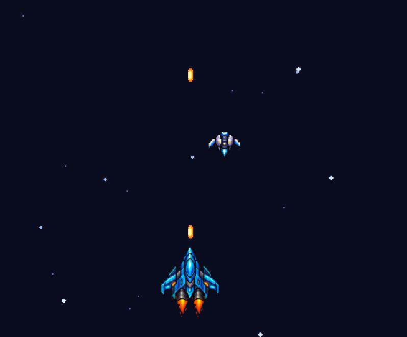

# 🚀 GALAXY DEFENDERS

A small 2D arcade space shooter made with **Python** and **Pygame**.
Jump into the cockpit, dodge enemy fire, destroy incoming ships, and try
to make it onto the **Top 10 High Scores**!



## 🎮 What's in the game?

-   Player spaceship with movement and automatic shooting.
-   Different enemy types, with their own behaviour and attacks.
-   Player and enemy projectiles, collisions, lives, and score.
-   Starfield background and arcade-style visuals.
-   Game Over screen with a persistent Top 10 leaderboard.
-   Sound effects and background music.

## 🕹️ Controls

  Key           Action
  ------------- ---------------------------------------------
  Arrow keys    Move the spaceship
  `SPACE`       Start the game / restart after Game Over
  `ESC`         Exit from the Game Over screen
  `BACKSPACE`   Delete a character while entering your name
  `ENTER`       Save your name to the leaderboard

## ⚙️ Requirements

-   Ubuntu (or another Linux distribution)
-   Python 3.12
-   Pygame 2.6.1
-   Git (optional, if you are cloning the project)

## 🚀 Installation and launch

Open a terminal in the project folder and follow these steps.

**1. Install Python tools (Ubuntu):**

``` bash
sudo apt update
sudo apt install python3 python3-pip python3-venv
```

**2. Create and activate a virtual environment:**

``` bash
python3 -m venv .venv
source .venv/bin/activate
```

**3. Install Pygame:**

``` bash
python -m pip install pygame==2.6.1
```

**4. Start the game:**

``` bash
python main.py
```

To play again after Game Over, press `SPACE`. Have fun!

## 📁 Project structure

``` text
GalaxyDefenders/
├── main.py
├── assets/
│   ├── images/
│   ├── sounds/
│   ├── fonts/
│   └── data/
└── src/
    ├── player/
    │   ├── player.py
    │   └── player_config.py
    ├── enemies/
    │   ├── enemy.py
    │   └── enemy_config.py
    ├── projectiles/
    │   └── projectile.py
    └── game/
        ├── game.py
        ├── settings.py
        ├── stars.py
        ├── score.py
        ├── display.py
        ├── high_scores.py
        ├── game_over.py
        ├── enemy_manager.py
        └── sounds.py
```

## 🔊 Audio

Audio is managed centrally in `src/game/sounds.py`.

-   **Background music:** `assets/sounds/music_game.mp3` --- generated
    with **Suno AI**.
-   **Player shot:** `assets/sounds/player_shot.wav`.
-   **Enemy explosion:**
    `assets/sounds/galaxy_defenders_arcade_explosion.wav`.

The sound effects were created with **ChatGPT**. Check the terms of the
relevant tools and services before redistributing their generated audio,
especially in commercial projects.

## 🏆 High Scores

The game stores the Top 10 scores in:

``` text
assets/data/high_scores.json
```

The file is created automatically when a score is saved. If it does not
exist yet, the game starts with an empty leaderboard.

## 🧩 How the code is organised

-   `main.py` starts Pygame and manages restarting the game.
-   `src/game/` contains the main game loop, settings, display, score,
    leaderboard, enemy management, and audio.
-   `src/player/`, `src/enemies/`, and `src/projectiles/` contain the
    code for the player, enemies, and projectiles.
-   `assets/` contains the images, sounds, fonts, and saved score data.

## 🛠️ Development notes

This project was built as a hands-on way to learn Python and Pygame.
Development was done step by step: understand a feature, implement it,
run the game, test it, and fix any issues before moving on.

AI assistance was used as a learning aid to explain concepts, review
code, and help troubleshoot problems. The goal was to understand the
code rather than simply paste in solutions. One project rule was to use
`while` loops instead of `for` loops.

## 🌟 Possible future improvements

-   More enemy types and attack patterns.
-   New levels and difficulty progression.
-   Additional power-ups and visual effects.
-   More gameplay and audio options.

------------------------------------------------------------------------

## 👨‍🚀 Author

Created by **David Castro**.

Developed as a personal project to learn Python and Pygame.

**Thanks for playing GALAXY DEFENDERS!**\
Now get out there and defend the galaxy. 🛸
